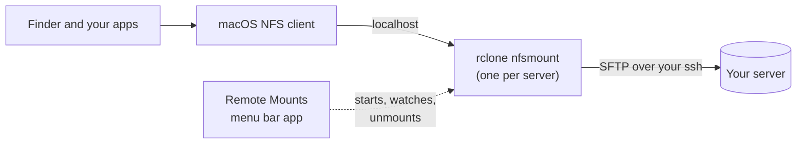

<p align="center">
  
</p>

<h1 align="center">Remote Mounts</h1>

<p align="center">
  <b>Mount your SSH servers as folders on your Mac, and use them in Finder like local files.</b>
</p>

<p align="center">
  
  
  
  <a href="LICENSE"></a>
</p>

> [!WARNING]
> **Remote Mounts is a work in progress.** It's a personal project that has so far been used on one Mac (macOS 27, Apple silicon) with a handful of Linux servers. Expect rough edges and breaking changes between versions.
>
> - **Keep backups of anything important.** Files you save into a mounted folder upload in the background. Unmounting or quitting waits for those uploads, but quitting while Finder is still copying a folder stops the copy partway, just like ejecting a disk mid-copy.
> - **The app isn't notarized by Apple**, so macOS will warn you the first time you open it (see [Install](#install)).
> - Please [open an issue](https://github.com/josusanmartin/remote-mounts/issues) if something goes wrong; the log for each server is one click away in the app.

---

## What it does

Pick a host from your `~/.ssh/config`, and Remote Mounts shows that server as a folder (by default `~/Mounts/<name>`). Browse it in Finder, open files in any app, save, drag and drop. Everything goes over your normal SSH login: no server software to install, no kernel extensions, no admin password.

It lives in the menu bar, with a full window for managing servers.

### Highlights

|  |  |
| --- | --- |
| 🖱️ **One click** | A switch per server in the menu bar. Click a row to mount it and open it in Finder. |
| 🔑 **Uses your SSH setup** | Hosts come straight from `~/.ssh/config`. Passphrase-protected keys get a one-time prompt and can be remembered in your Keychain. |
| ⚡ **Fast on slow links** | Tuned for distant servers: files you open are cached locally, folder listings are remembered, and connections are kept warm. |
| 👀 **Live updates** | Files and folders created on the server show up in Finder within seconds, not when a cache expires. |
| 🛟 **Safe unmount and quit** | Pending uploads finish first, with a live count and a "Quit Now" escape. Anything cut short resumes on the next mount. |
| 🔁 **Recovers on its own** | Reconnects with backoff, retries as soon as the network comes back or the Mac wakes, and cleans up after crashes. |
| 📊 **See what's happening** | Live uploads, transfer speed and cache usage per server, plus notifications with plain-English errors. |
| 🧭 **No typing paths** | Browse the server to pick the folder to mount; Test Connection checks everything before you mount. |
| 💻 **Terminal friendly** | Open an SSH session in the mounted folder, and ⌘-click server paths in iTerm2 to open or download them. |

### Everything else

- Per server: remote folder, local folder, mount at launch, read-only, cache size, how long folder listings are remembered, and extra rclone flags (the full command is shown and copyable).
- Duplicate, reorder and remove servers; removing one never touches the server.
- Open at login, keep in the Dock (handy when the notch hides menu bar icons), notifications on or off.
- Built-in log viewer per server, with an errors-only filter.

## Install

1. Install [rclone](https://rclone.org), which does the actual file transfer:

   ```sh
   brew install rclone
   ```

2. Download **Remote-Mounts-x.y.z.zip** from the [latest release](https://github.com/josusanmartin/remote-mounts/releases), unzip it and drag **Remote Mounts** to Applications.

3. Open it. Because the app isn't notarized, macOS blocks the first launch:
   - Open **System Settings → Privacy & Security**, scroll down and click **Open Anyway** next to "Remote Mounts was blocked", or
   - run this once in Terminal:

     ```sh
     xattr -dr com.apple.quarantine "/Applications/Remote Mounts.app"
     ```

4. Add a server: pick a host from your SSH config, then **Add & Mount**.

**Requirements:** macOS 15 or later, Apple silicon or Intel, rclone from Homebrew, and servers you can already reach with `ssh <host>` and that have SFTP enabled (almost all do).

## Build from source

You need the Xcode command line tools (`xcode-select --install`).

```sh
git clone https://github.com/josusanmartin/remote-mounts.git
cd remote-mounts
./build.sh           # builds "build/Remote Mounts.app"
./build.sh install   # also installs to ~/Applications and relaunches it
./build.sh release   # universal build, zipped for a GitHub release
```

## How it works



Each mount is an `rclone nfsmount` that serves the server over NFS on `localhost`, which the built-in macOS NFS client mounts. That's why no FUSE, kernel extension or admin rights are needed. rclone reaches the server through your own `ssh` command, so your SSH config, keys, jump hosts and agent all just work.

<details>
<summary><b>Tuning for slow links</b></summary>

Remote Mounts was built against a server about 250 ms away, where the defaults made Finder hang:

- **No remote hashing.** By default every file open runs `md5sum` over a fresh SSH login (about 3 s on a slow link). Hashing is off, and files are compared by size and date.
- **Connections capped at 16 and kept open.** sshd's default `MaxStartups 10` drops bursts of new logins, so connections are reused instead.
- **Local cache.** Files you open are kept on the Mac (10 GB by default, per server), so opening them again is instant.
- **Remembered folder listings** (10 minutes by default). Longer makes browsing faster, but files created on the server show up later.

</details>

<details>
<summary><b>Live updates</b></summary>

SFTP can't tell clients that something changed, so while a server is mounted the app runs a small helper on it: `tools/rm-watch.py`, sent over SSH to the server's own `python3` (nothing is installed, and it exits when the mount does). It uses Linux inotify to watch folders, nearest first, and reports each one that changes. The app then tells rclone to forget just those folders, and the Mac's NFS client re-checks folders every 1 to 3 seconds, so Finder picks up the change. It takes about 16 MB of memory on the server for 20,000 folders.

Turn it off per server under **Changes on the Server**.

</details>

<details>
<summary><b>Unmounting safely</b></summary>

- Unmounting always goes through the running rclone first. If rclone is killed before the kernel lets go, the NFS mount is left pointing at a server that's gone, and unmounting it hangs. If that happens anyway (a crash), the app briefly stands in a throwaway `rclone serve nfs :memory:` on the old port so the unmount can finish.
- Unmounts go through Disk Arbitration first, so Finder drops the volume instead of keeping a dead entry in its sidebar.
- Before unmounting or quitting, the app flushes the Mac's buffered writes and asks rclone directly whether anything is still uploading.

</details>

<details>
<summary><b>Passphrase-protected SSH keys</b></summary>

The app's SSH connections can't show a passphrase prompt, so when a server's key is locked, Remote Mounts asks for the passphrase once in its own window and adds the key to the macOS SSH agent. Every connection then shares it: rclone's, the folder browser's and Terminal's. With **Remember in my Keychain** on, the key is reloaded silently after a restart.

The passphrase goes straight to the system `ssh-add` and is never written to disk or to rclone's config.

</details>

## ⌘-click server paths in iTerm2

When a command on a server prints a path such as `/home/you/report/chart.png`, ⌘-click it in iTerm2 and it opens from the mounted folder on your Mac. Paths starting with `~/` and paths relative to the current folder work too, `file.py:42` opens in VS Code at that line, and links and local files open as usual.

Turn it on in **Remote Mounts → Settings → iTerm2**. A dialog asks what to do with each file: **Open** it from the mount, **Download** a copy to your Downloads folder, **Show in Finder** or **Cancel**. In the same place you can skip the dialog and always open or always download.

Under the hood, the app links `~/.local/bin/rm-open` to the script inside the app and sets iTerm2's semantic history (Profiles → Advanced → Semantic History → **Always run command…**) to `~/.local/bin/rm-open \1 \5 \2`. iTerm2 reads that setting at launch, so restart it after turning the option on or off.

## Known limitations

- Tested on a single Mac so far; other macOS versions and setups may hit bugs that haven't been seen yet.
- Not notarized or signed with a Developer ID, so macOS warns on first launch.
- Needs rclone installed separately.
- Live updates need `python3` on a Linux server, and watch up to 20,000 folders (nearest first, skipping hidden ones and folders like `node_modules`). Changes elsewhere show up when the remembered folder contents expire (10 minutes by default).
- Servers that only accept passwords (no SSH keys) aren't supported yet.
- The iTerm2 option applies to profiles that exist when you turn it on.

## Where things live

| What | Where |
| --- | --- |
| Server list | `~/Library/Application Support/RemoteMounts/mounts.json` |
| Logs (one per server) | `~/Library/Logs/RemoteMounts/` |
| File cache | `~/Library/Caches/RemoteMounts/` |
| Open at login | `~/Library/LaunchAgents/dev.josu.RemoteMounts.plist` |

## License

[MIT](LICENSE)
